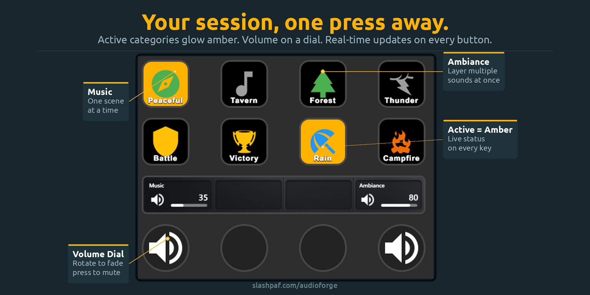

# Audio Forge for Stream Deck

Control Audio Forge playback from Elgato Stream Deck or OpenDeck. The plugin talks to Audio Forge's Local API over HTTP and WebSocket; no cloud account or MQTT broker is required.



## Actions

| Action | What it does |
| --- | --- |
| Play / Pause | Toggle Music or Ambiance playback |
| Stop | Stop Music, Ambiance, Echoes, or all playback |
| Next Track | Skip to the next track in the active Music or Ambiance categories |
| Category | Toggle a Music or Ambiance category |
| Echo | Trigger a one-shot Ambiance sound |
| Volume | Set a keypad preset or adjust volume with a Stream Deck+ dial |
| Library | Switch the active library |
| Restore Saved State | Restore a saved Audio Forge state |

These are seven action types across eight manifest entries; Volume has a keypad preset and a separate Stream Deck+ dial. Buttons update from Audio Forge's live state. Category and Library actions show their selected item, and reconnect automatically when Audio Forge restarts.

## Requirements

- Audio Forge with its Local API enabled (default port `8329`).
- OpenDeck on Linux, or Elgato Stream Deck software 6.9 or newer on Windows/macOS.
- The Stream Deck Node.js runtime must be Node 20.5.1 or newer (required by the Elgato SDK).

The manifest retains Elgato's standard `mac` and `windows` platform declarations. OpenDeck runs the plugin as a Node.js plugin on Linux; a `linux` manifest entry is not needed.

## Install with OpenDeck

Download the `.streamDeckPlugin` file from the latest [GitHub Release](../../releases/latest) and install it from OpenDeck's plugin manager using **Install from file**.

The release installer contains the plugin bundle. GitHub lists the SHA-256 of every release file if you want to verify a download. OpenDeck also accepts the `Audio-Forge-vX.Y.Z-opendeck.zip` archive attached to each release.

## Configure the Local API

1. In Audio Forge, open **Settings → Local API** and enable the server.
2. Drag an Audio Forge action onto the deck.
3. Expand **Connection Settings** and enter the Audio Forge host, port, and optional API key. Defaults are `localhost`, `8329`, and no key.

The API key field is masked. The plugin omits the key from its own connection logs. The Local API currently uses plain HTTP/WebSocket (`http://` and `ws://`), so a key is not encrypted when sent to a remote host; use `localhost` or a trusted network.

## Build from source

Requires Node.js 20.5.1 or newer and npm.

```sh
./build.sh
```

The compiled entry point is `com.slashpaf.audioforge.sdPlugin/bin/plugin.js`. The build creates both package formats under `dist/`:

- `dist/opendeck/Audio-Forge-v1.0.5-opendeck.zip` — the unencrypted OpenDeck archive, with the `.sdPlugin` folder at its root and a SHA-256 checksum beside it.
- `dist/elgato/com.slashpaf.audioforge.streamDeckPlugin` — the Elgato installer for Stream Deck and Maker Console submission.

The Elgato package is unencrypted when produced locally; Marketplace DRM is applied after Elgato processes it in Maker Console. The build requires the pinned Elgato CLI installed by `npm ci`. Both packaging targets include the root `LICENSE` and `ASSET_LICENSE.md`, and filter logs, source maps, local environment files, and common credential files. Linux/macOS packaging also requires `zip`, `unzip`, and either `sha256sum` or `shasum`; on Windows, `build.bat` uses PowerShell.

The build includes the pinned `sdpi-components` property-inspector library locally, so settings pages do not fetch executable code from a CDN at runtime. Third-party notices are in the plugin bundle's `licenses/` directory.

The GitHub Actions workflow builds and checks only the `.streamDeckPlugin` installer. Pushing a version-matched `vX.Y.Z` tag creates a **draft** GitHub Release with that installer and its checksum for maintainer review.

## Development notes

- `src/plugin.ts` registers actions and starts the shared Audio Forge client.
- `src/audioforge-client.ts` handles the WebSocket connection, state updates, reconnects, and app launch requests.
- `src/actions/` contains the Stream Deck actions.
- `com.slashpaf.audioforge.sdPlugin/ui/` contains local property-inspector pages and styles.

## License and brand assets

The Stream Deck plugin's code and documentation are available under the MIT license. This does not open-source the Audio Forge application or generally license its name and branding. Current plugin images may be redistributed unchanged only with this plugin; forks must replace them. Third-party components retain their own licenses; see [THIRD_PARTY_NOTICES.md](THIRD_PARTY_NOTICES.md). Screenshots remain outside the code license; see [ASSET_LICENSE.md](ASSET_LICENSE.md).
